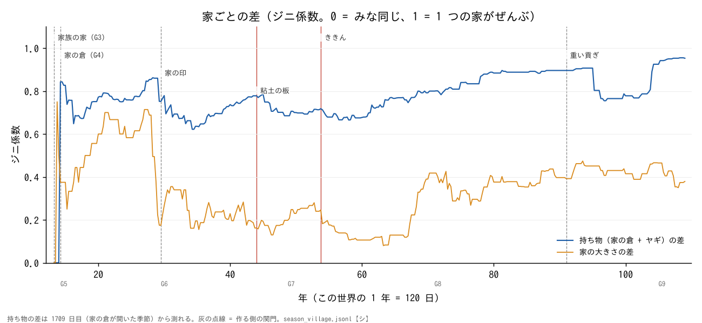

# 川辺の村と人類史: 同じところ・違うところ・テクノロジー・人間らしさ (まとめ)

書いたのは Claude (2026-10-29)。本人の問い (2026-10-29):「実際の人類史とは何が同じで何が違うのか、その中でテクノロジーはどういう役割を果たしているのか、そこでの人間らしさは何か」。つづけて本人「つまり人間らしさをシミュレートしたい」。
記録は 108年120日目 (13079 日目、G9 の 4 年目の終わり) まで。数はみな【シ】(シミュレーションの記録から数えた)。確かさの札は、ほかの文書と同じ (【文献】【記憶】【仮定】)。

くわしくは 3 つの部分にある:
- [1. 同じところと違うところ](part1_same_and_different.md)
- [2. テクノロジーの役割](part2_technology.md) (図 4 枚: [人](fig_tech_population.png)・[蓄え](fig_tech_store.png)・[差](fig_tech_inequality.png)・[食べ物](fig_tech_diet.png))
- [3. 人間らしさ](part3_humanness.md)

## 1. ひとことで

- **暮らしのテクノロジーは、人類史の順にほぼ合った。社会のしくみは、途中で止まった。**
- **テクノロジーは「社会を動かす力」ではなく「できることの床」だった。** 多くは作る側の関門で開き、開いても、使うわけと使い続ける人がいなければ止まった。
- **村は人間らしい所もあるが、いちばん大きな違い (争わない・罰しない・上に立とうとしない) は、人間よりも LLM のくせに近い。** だから「人間らしさのシミュレーション」には、まず人間らしさの物差しが要る。

## 2. 同じところと違うところ (くわしくは 1.)

| | 中身 |
|---|---|
| 同じ | 定住 → 植物を育てる → 畑 → ヤギ → 鎌 → 土器 → 受けつぎ・家の倉 (西アジアの順)。文字は帳簿から (板の使い道はもめごとの量の確かめ)。印は「だれが封を割ったか」に使った。豊かなときは新しいものを作らない。ききんのときは従うより出ていく。強い相手にはすぐ払い、重すぎると離れる |
| 違う | 土器が家の倉より先。火がとても遅い (6年)。記録が先で町はできなかった (史実は町が文字より約 900 年早い)。持ち物の差 (ジニ 0.7〜0.95) が本物 (0.4〜0.5 ほど【記憶】) よりずっと大きい。食べ物の 7〜9 割が木の実。人はよそから来て増えた |
| 起きなかった | 税・守らせた書いた法・役所・王・戦・壁・神殿・生まれで決まる身分・町・言葉を書く文字 |
| 違いのわけ | 作る側の作り方 (フェーズの関門・時間の縮め方・置いた集落・札・やり直し・とちゅうのモデルの切り替え) / 世界の決まり (木の実がただで取れる・まわりの村が小さい) / LLM の選び方 (決まりの村なら税と記録に 12 回のうち 12 回届くのに、LLM の代表は選ばなかった) |

## 3. テクノロジーの役割 (くわしくは 2.)

- **だれが開いたか:** 土器・鎌・家族の住まい・家の倉・印・数え札・板は、作る側のフェーズの関門で開いた。村の人が自分で始めたのは、畑・火 (ウィロ 1 人)・ヤギを捕まえる・黒曜石の旅。
- **床を上げた:** 土器で虫とネズミの害が 0 になり、蓄えは 200 日分ほどから 300 日分台へ。
- **差を生んだ (ただし作り方で):** 家の倉が開いた季節に、持ち物のジニは 0 から 0.84 へはね上がった。最後は 0.95 (27 家のうち 23 家が何も持たない)。「蓄えが差を生む」という史実の見方【文献】と同じ向きだが、ここでは関門が蓄えを家ごとに分けたことが直接のわけ。
- **印は持つ家の守りになった:** G7 のききんで、村の蓄えは空なのに家の倉には 101〜340 日分あった。封を割ったもめごとは 180。
- **記録はあったが、税はなかった:** 板は G6 に 13 季節使われ、G7 のあとは使われなくなった。記録をつける人が亡くなると、記録も止まった。
- **赤い金属の刃は 37 年しまわれていた:** 蓄えが 23 日分になった G9 の最初の集まりで、村は「使う」を選んだ。
- **大きな苦しみは、テクノロジーの足りなさから来なかった:** G7 のききんはお題と仕組みの作り方、G8 は重い貢ぎから。どちらも道具は余っていた。
- **思いつきは安かった:** LLM は今の知識を持っているので、板が使えるようになる 11 年前に「板に刻む掟」が出た。足りなかったのは、使うわけと使い続ける人。

## 4. 人間らしさ (くわしくは 3.)

| 人間らしい | LLM らしい |
|---|---|
| 祭りで仲直りする。苦しい年によそ者を断る (49 年までは 0 人、そのあと 35 人)。子のために貢ぎをやめる。G5 では「つぐなう」が 32 対 9 で多かった (まとめ役セナ) | 50 年からは「つぐなう」が 0 (前例をまねて固まった見込み)。人に殺された人・戦・怒った言葉・地位を求める人が 0。悲しみ 66 のうち 43 が、同じ文で「みんなで刈ろう」になる |
| 言うことと、することが違う (「みんなで」5,391 回、家の倉から出したのは 0 回)。ただし、お題の書き方のせいかもしれない | モデルで振る舞いが分かれる (やめる・子の死の年の名前は opus、sonnet は賛成と刈り入れの名前)。「昔の人として」の 1 文で答えが大きく変わる |

人間らしさを測る決め方 (案。くわしくは 3.): (a) 自分の立場や損得で振る舞いが変わる、(b) 状況で変わり、戻れば戻る、(c) 違いがモデルではなく一人ひとりから出る、(d) 言うこととすることの違いが、お題の書き方だけから来ない。

## 5. 弱いところ

- 走りは 1 回だけ (種 1 つ。やり直しもある)。前後のくらべは、同じころの関門・世界・お題・モデルの変更と重なって、分けられない。
- 体の時間は縮めていない。何世代もかかることは起きにくい。
- LLM は人類史を知っている。板・1 割の上乗せ・すぐ払う、は「知識の再現」かもしれない。
- くらべる物差しは西アジアだけ。【記憶】の数は資料で確かめていない。

## 6. 次: 人間らしさをシミュレートするために (相談の材料)

1. **物差しを作る:** 人間のデータがあることで測る。経済ゲーム (最後通牒・独裁者・罰のある公共財。小さな社会 15 の研究 Henrich ほか 2005【記憶】)、小さな社会の暴力・差・もめごとの割合。本物の人 20〜30 人に同じ場面を答えてもらうと、「LLM は人より協力的でやさしい」かを初めて確かめられる (トークンはほとんど要らない)。
2. **お題のかたよりを外す:** 空欄のときの手を逆にする・前の例を消す・裁く側と裁かれる側を入れ替える (約 1,450 万トークン)。
3. **人間らしさの元を持たせる:** 一人ひとりの気質を人間の分布でばらけさせる、恨みと恩の記憶、腹・子・見下されることへの気持ち。写しの村でくらべる。
4. **モデルをくらべる:** 53 年の写しから 5 年、haiku だけ・sonnet だけ・opus だけ・今の混ぜ方 (約 1.2 億トークン)。
5. **テクノロジーを関門でなく前提で開く村** (テクノロジーツリーの案 B・C) とくらべて、「テクノロジーが社会を変えるか」を確かめる。
