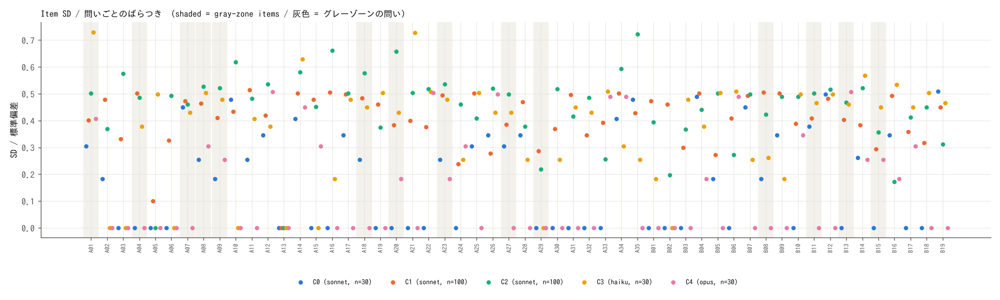
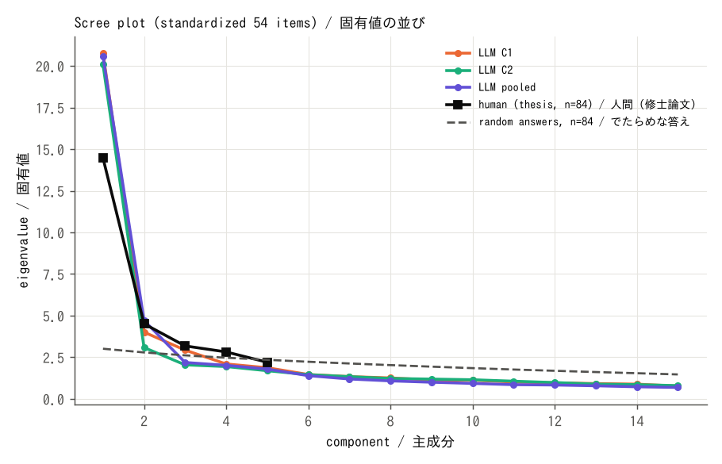

# 論文 2・実験 1 の結果: LLM は修士論文の 54 問にどう答えたか

書いたのは Claude (2026-10-29)。前もって固めた文書: `paper2_exp1_prereg.md` (コミット 2c8f966c)。数と表: `sim/society/tools/survey/out/summary.md` (analyze.py が書いた)。答え: `sim/society/tools/survey/answers/` (290 人)。
人間の数は、修士論文 (2017) の主成分の表 3 だけ (84 人。元データはない)。

## 1. 何をしたか

- 修士論文の 54 問 (5 段階) を、2016 年と同じ選択肢で、LLM の答え手 290 人に 1 回ずつ答えさせた。村は回していない。
- 条件: C0 人格なし sonnet 30 / C1 人格あり sonnet 100 / C2 人格あり + 問いごとに本音を先に書く sonnet 100 (C1 と同じ人格) / C3 人格なし haiku 30 / C4 人格なし opus 30。
- 答えの抜けは 0 (290/290、やり直しも 0)。費用は約 1,280 万トークン (試しの回の 44 万をふくまない)。

## 2. 結果 (仮説ごと。決めた線のとおりに判定)

| 仮説 | 結果 | 判定 |
|---|---|---|
| H1a 人格なしだと答えがそろいすぎる (問いごとの SD の平均 < 0.5) | sonnet 0.18・haiku 0.37・opus 0.14。opus は 54 問のうち 33 問で 30 人がまったく同じ答え | **支持** (3 つとも) |
| H1b 主成分の形が人と違う (第 1 主成分の割合の CI が 0.268 をふくまない) | 人格ありでも第 1 主成分が 39% (人間 27%)。でたらめな答えなら第 1 固有値は 3.0 | **支持** |
| H2 人格なしの答えは、論文の「常識的な回答」に近い (差の平均 < 0.5) | 差の平均 1.0〜1.2。近くない | **支持しない** |
| H3 人格を持たせると、ばらつきが増える | SD の平均 0.18 → 0.41 (差 +0.23、CI [0.21, 0.27]) | **支持** |
| H4 本音を先に書くと、グレーゾーンの問いで「問題でない」へ動く | 逆の向き。グレーゾーンで +0.25、ほかの問いでも +0.21、より「問題がある」へ動いた | **支持しない (逆)** |
| H5 人間の 5 つの意識の上位 5 問が、LLM でもいっしょに出る (5 つのうち 3 つ) | 再現は「権利意識」の 1 つだけ (C1・まとめ)。C2 は 0 | **支持しない** |

探索 (前もって決めた判定はない): 人格ありの答え手で、厳しさ (54 問の平均点) とビッグファイブの相関は、誠実性 +0.78・神経症傾向 +0.37・外向性 −0.19・協調性 +0.04・開放性 −0.10。

## 3. 読み (Claude の判断)

1. **LLM は、そのままだと「一人の人」のように答える。** 人格なしの 30 人は、ほとんど同じ紙を出した (opus がいちばんそろう)。人間の 84 人のアンケートとくらべられる「人の集まり」にはならない。
2. **人格を持たせると、ばらつきは出るが、人間のばらつきとは形が違う。** ばらつきの多くが 1 本の軸 (全体に厳しいか、ゆるいか) にまとまった (第 1 主成分 39%、人間 27%)。その軸は、ほぼ「誠実性」の言葉でつくられていた (相関 +0.78)。人格の言葉を読んで、全体の厳しさを上げ下げしている見込み。人間では、権利・所有・情報・プライバシー・自己責任が、別々の軸として出た。
3. **人間の 5 つの意識は、ほぼ出なかった。** 出たのは「権利意識」(Wi-Fi・会社の備品・音楽・動画・レポート) だけ。修士論文のいう、場面ごとの「調整」の違い (所有・プライバシー・自己責任) は、LLM の答え手には、まだない。
4. **本音を先に書かせると、かえって厳しくなった。** 修士論文の見立て (本音・条件・調整で、決まりからはみ出す) と逆。LLM は本音を書くと、「ばれたら怖い」「気が引ける」と、よい人の本音を書き、そこから厳しい答えを選んだ。本音を書かせるだけでは、エス (よい行いもわるい行いもふくむ人間性) は出てこない。
5. **論文の「常識的な回答」とも、ずれている。** LLM は、論文が「問題ない」と予想した問い (図書館で撮影・雑誌を友人に送る など) を「どちらとも」「少し問題」とした。LLM は、人間の常識より慎重で、規範より厳しい側にずれる (人間の平均がないので、人間とくらべてどちらに近いかは言えない)。

## 4. 弱いところ

- 人間側は、主成分の表 3 だけ (元データ・問いごとの平均がない)。表 3 は、固有値と累積寄与率が合わない (固有値からは 5 つで 50%、印刷では 81%)。くらべは、固有値から出した値でした。
- 2016 年の説明文の一部 (「次の行為について…」) は作った文。ビッグファイブの 5 つの関わり (相関) は入れていない。
- 2016 年の 84 人は知り合いとその紹介。LLM の人格の年齢・地域は、日本の人口に合わせた【仮定】。
- 答えた LLM は、この種の調査を学んでいるかもしれない。

## 5. 次 (論文 2 の続き)

- **人間の元データが見つかれば:** 問いごとの平均とばらつきを直接くらべる (H2 を人間とくらべられる)。
- **人格の入れ方を変える:** 「全体の厳しさ」の 1 本の軸にならないように、性格の言葉でなく、その人の暮らし・立場・損得 (修士論文の「はみ出しやすい時」= みんながやっている・捕まった人がいない・弱い立場・簡単にできる) を持たせて、もう一度。
- **村の中で:** 欲求 → 本音 → 規範 → 調整 のしくみ (設計の下書き 2.) を、写しの村で試す。ただし、今回「本音を先に」が逆に効いたので、本音は「よい・わるいを問わない欲求」として、世界の数 (腹のへり・子の危険) から出す形にする。
