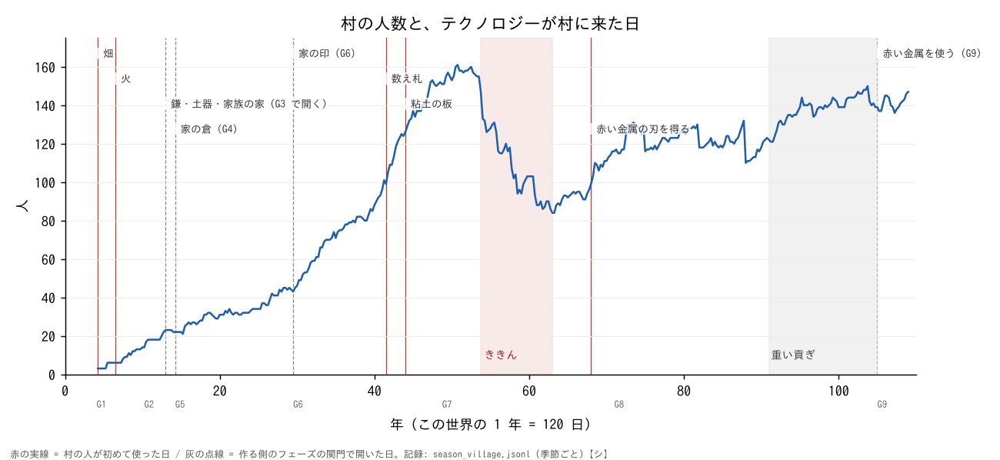
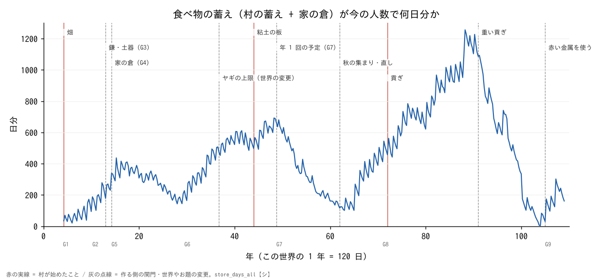
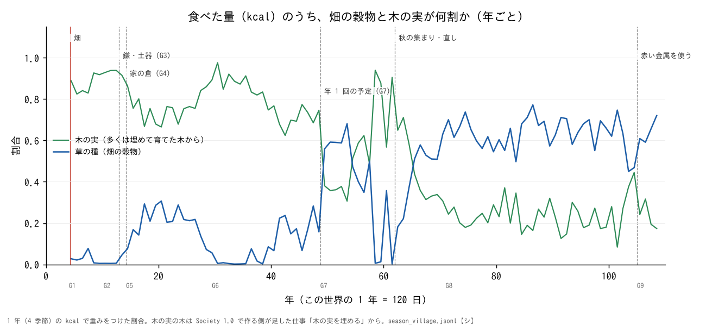

# 問い 2: この村の歴史で、テクノロジーはどんな役割を果たしたか

書いたのは Claude (2026-10-29)。本人の問い「実際の人類史とは何が同じで何が違うのか、その中でテクノロジーはどういう役割を果たしているのか、そこでの人間らしさは何か」の 2 つめ。読んだだけで、データもコードも変えていない。

材料: `sim/society/data/records/season_village.jsonl` (季節ごと 420 行。489〜13079 日目)・`disputes.json`・`laws.json`、`archive.load_state('data')` で戻した出来事 (110 万件)、`sim/society/techtree/plan.json`・`emerged.json` (届いた日は `tools/build_tech_tree.py --out` で作り直して読んだ)、`docs/tech_tree_design_draft.md` の 1.3 (コードで技術がどう開くか)、`docs/society_phase/society1_overview.md`・`G6.md`・`G7.md`・`G8.md`・`G8_heavy.md`、`sim/society/g9.py`、`docs/research/economic_lenses.md`。

**印**: 【文献】調べの文書が文献から引いたこと / 【記憶】Claude の記憶だけで確かめていない / 【仮定】Claude の読み / 【シ】このシミュレーションの記録から数えた数。

**出典**: 外から持ってきた研究 (本人の修士論文・論文や本・ゲーム・道具・AI) の書誌と、確かめたかどうかは [`docs/research/references.md`](../references.md) にまとめた (2026-10-30)。ここで【記憶】とした文献のうち、のちに書誌を確かめたもの (Kohler ほか 2017・Henrich ほか 2005 など) は、一覧の「確かめ」に書いた。この文書の中身は変えていない。

**読み方**: この世界の 1 年は 120 日。長さではなく、順番と「何が変わったか」をくらべる。1 回の走りで見たことで、一般の決まりではない。

## 0. まとめ (先に)

- 【シ】この村のテクノロジーは、多くが **「村が見つけた」のではなく「作る側が開けた」**。土器・鎌・家族の家・家の倉・印・数え札・板・赤い金属の使い道は、どれもフェーズの関門か、コードの変更で開いた。村が自分で始めたのは、畑・火・ヤギ捕り・数え札と板を「使うこと」など。
- 【シ】いちばん効いたのは **食べ物をためる技術** (土器・家の倉) と **食べ物を作る技術** (育てた木・畑)。人も蓄えも、これらのあとで増えた。
- 【シ】**家の倉が開いた季節に、家ごとの差 (ジニ係数) が 0 から 0.84 にとんだ**。史実の「ためる → 差が開く」と同じ向き。
- 【シ】**記録の道具は、税にも役所にもつながらなかった**。板はもめごとの量を確かめるのに使われ、つける人が亡くなると止まった。
- 【シ】**大きな危機 (G7 のききん・G8 の重い貢ぎ) は、技術の不足ではなく、仕組みの作り方と外からの取り立てで起きた**。どちらのときも、道具 (土器・鎌) は余っていた。
- 【仮定】この村でのテクノロジーの役割は、「社会を変えるエンジン」より「**できることの床**」に近い。床ができても、村の人 (LLM) が困らないかぎり、新しい仕組みは足されなかった。

## 1. テクノロジーはどうやって村に来たか

`tech_tree_design_draft.md` の 1.3 によると、このコードには「知識による技術の木」がない。開き方は 5 つ (最初からある仕事・フェーズの関門・持ち物・世界のようす・技能)。下の表は、それを「だれが開けたか」で分けたもの。

| テクノロジー | 開き方 | 村で初めて | 印 |
|---|---|---|---|
| 畑・ヤギ捕り | 最初からある仕事 (G1 から選べた) | 4年31日目 (510)・4年91日目 (570) | 【シ】 |
| 火 | 最初からある仕事。村ではウィロ 1 人だけ | 6年62日目 (781) | 【シ】 |
| 住まい・木の実を埋める・木から取る | Society 1.0 で村が止まったとき、作る側がコードに足した (10-01・10-06・10-07) | 151・335・284 日目 | 【シ】 |
| 鎌・土器・家族の家 | **G3 の関門で開く** (虫とネズミの害も同じ日に開く) | 13年1日目〜13年32日目 (1560〜1591) | 【シ】 |
| 家の倉・受けつぎ | **G4 の関門で開く** | 13年120日目 (1679)・14年30日目 (1709) | 【シ】 |
| 家の印・封・数え札・封筒・板 | **G6 の関門と「困りごとのあと」の決まり**で開く。使うかは村 | 印 29年60日目 (3539)・板 44年1日目 (5280) | 【シ】 |
| 黒曜石の刃 | 北の村にある物 (世界の置き方)。取りに行ったのは村 | 41年5日目 (4924) | 【シ】 |
| 赤い金属 (青銅) の刃 | よその便り (作る側の札) で運ぶ人が来た。受けたのは村 | 67年120日目 (8159) | 【シ】 |
| 赤い金属を使う | **G9 のコードで初めて「使う / しまう」の欄ができた** | 104年120日目に「使う」と決め、105年30日目 (12629) に 30 人日 | 【シ】 |
| 犂 | この世界に牛がいないので、できない | なし | 【シ】 |

【シ】予定の木の要素 92 のうち、届いた 50・届かなかった 16。届いた日が予定より早い 7・遅い 10。「創発」として選ばれた 11 のうち、テクノロジーの新しい道具を村が作り出したものは 0 で、どれも **使い方が予定と違った** もの (板の掟が板より 11 年早い・封を盗みの見張りに使う・ヤギを干し肉にする、など。`emerged.json`)。

## 2. 来たあと、何が変わったか

来た日の前 2 年と後 2 年 (8 季節ずつ) をくらべた 【シ】。蓄えは「村の蓄え + 家の倉」が今の人数で何日分か (中央値)。

| 来たもの (日) | 人 (前 → 後) | 蓄え 前 → 後 (日分) | 1 年に亡くなった人 前 → 後 | 持ち物のジニ 前 → 後 |
|---|---|---|---|---|
| 鎌・土器・家族の家 (1560〜1591) | 18→23 / 23→21 | 197 → 280〜300 | 0 → 1〜1.5 | (なし) → 0.51 |
| 家の倉 (1709) | 20→22 / 22→26 | 251 → 336 | 1 → 1 | 0.21 → 0.77 |
| 家の印 (3539) | 44→43 / 45→55 | 172 → 264 | 2.5 → 2.5 | 0.83 → 0.72 |
| 粘土の板 (5280) | 109→126 / 129→137 | 533 → 564 | 3 → 5 | 0.77 → 0.76 |
| 赤い金属を得る (8159) | 95→99 / 103→111 | 332 → 400 | 5.5 → 2.5 | 0.76 → 0.79 |
| 赤い金属を使う (12629) | 148→137 / 137→136 | 40 → 145 | 14 → 10 | 0.89 → 0.95 |

読めること:

1. **土器は、虫の害とセットで開いた**。G3 に入った季節に虫とネズミの害が 5,410・7,727 (土器 0 個)。土器が 340 個になった 1709 日目には 62、G5 では 0。蓄えは約 200 日分から 300 日分台になった 【シ】。ただし **困りごと (虫) も解き方 (土器) も、同じ関門で作る側が開けた**。これは「必要が発明を生んだ」のではなく、「作る側が問いと答えを一緒に置いた」形 【仮定】。
2. **主食を変えたのは、作る側が足した「育てた木」**。G6 (48年) まで、食べた量の 7〜9 割は埋めて育てた木の実で、畑の穀物 (草の種) が半分をこえたのは G7 から (下の図)。「育てたものの割合」(`farm_share_season`) は G1 から 0.78、G5 から 0.9 台で、畑より先に木が「農耕」を作った 【シ】。
3. **鎌は一度も足りなくならなかった**。季節の「限り」(`binding`) で鎌が限りになった季節は 0。土器が限りになったのは G3〜G4 の 6 季節と G6 の 14 季節だけ。G6 からの限りはほぼ毎季節「草」(ヤギの上限。作る側が 36年に足した世界の数) 【シ】。道具は、すぐに余るものになった。

## 3. 差を作ったのは「ためる場所」

- 【シ】持ち物 (家の倉 + ヤギ) のジニ係数は、家の倉が開く前 (1619〜1679 日目) は 0。家の倉に中身が入った 1709 日目に **0.843** (8 家のうち 6 家は持ち物 0)。このあと 0.62〜0.95 のあいだにあり、最後 (13079 日目) は 0.953 (27 家のうち 23 家が持ち物 0)。
- 【シ】差の大きさは「多い家と少ない家」より、「**倉を持つ家と持たない家**」で決まっている (`economic_lenses.md` 2.2: 倉を持つ家の中だけのジニは 0.38)。
- 【シ】G7 のききん (53〜62年) では、村の蓄えが 0 の季節にも家の倉には 101〜340 日分があり、上の 10 家が 85% を持っていた。封を割って食べるもめごとは 180 回。**印と封は、ここで「持つ家」を守る道具として働いた** (`G7.md` 2.、`emerged.json` E4)。
- 【文献】史実でも、家ごとの倉 (先土器新石器 B 期。Flannery) のあとに差が見えるという読みがある (`historical_records.md`)。【記憶】Kohler ほか 2017 (Nature) は、旧大陸で大きな家畜と犂のある社会ほどジニが高いとした。この村は犂も牛もないのに、倉だけで高いジニになった。
- 【仮定】ただし、この村で家の倉を開いたのは G4 の関門で、村が「自分の倉がほしい」と言い出したのではない。「ためる技術が差を生む」と言うより、「**ためる場所を家に分けた設計が差を生んだ**」と言うほうが正確。

## 4. 使われなかった技術・なくなった技術

| 技術 | 使えた日 | どうなったか |
|---|---|---|
| 数え札 | 33年90日目 (4049) | 初めて使ったのは 41年 (約 8 年あと)。使った季節は 4 |
| 封筒 | 33年120日目 (4079) | **一度も使われなかった** |
| 粘土の板 | 43年90日目 (5249) | G6 で 13 季節。G7 で 3 季節、最後は 55年30日目 (6629)。そのあと約 50 年、だれも記録をつけない |
| 赤い金属の刃 | 67年120日目 (8159) に得た | **37 年しまわれたまま**。使う欄ができた G9 のはじめ (蓄え約 23 日分) に「使う」と決めた |
| 干し肉 | Society 1.0 から (火 + 残った肉) | 4 人が知っていたのに一度もなく、できたのは 38年 (ヤギから) |
| 槍・入れ物・すり石・しっくい・布 | 槍と入れ物はコードにある | 一度もない (すり石・しっくい・布はコードにない) |

- 【シ】板の記録は、つける人が亡くなると止まった。G6 で記録した 1,110 日のうち 300 日はタユ3 とカイ2 で、2 人は 46年60日目に亡くなった。G7 で記録した 5 人も、みな亡くなるか村を出た。**技術は道具ではなく、人についていた**。
- 【シ】赤い金属は、村が持っていても使い道がコードになかった。G9 で欄ができた最初の集まりで、村の人は「蓄えは二十日ちょっとしかない。赤い金属の刃も出して使おう」(ナセ20) と言った。【仮定】「足りないときに、しまってあった物を出す」のは村の判断。でも 37 年使わなかったのは、村が選んだのではなく作る側の設計。この 2 つは分けて読む。
- 【文献】史実でも、使わない・なくなる技術はふつう (タスマニア・極北の例、レバントのろくろが儀式の器だけに使われ 2 回消えた。`tech_tree_design_draft.md` 4.4・4.5)。

## 5. 技術があっても、期待した変化が起きなかったところ

| 道具・条件 | 計画が期待したこと | 起きたこと 【シ】 |
|---|---|---|
| 板・数え札 (G6〜) | 取り立て・役所 (G7 の条件 2・F6) | 税の案はききんの 1 季節に 4 本だけ、採用 0。取り立ての記録 0。役の人 0 |
| 大きな蓄え (G8 で 1,200 日分) | 余りが国を生む | 税・役・罰・まとめ役は 34 年 0。余りは外の国への貢ぎで減った (村の蓄え 304 万 → 26.7 万つかみ) |
| 交換と貸し (G6〜) | 交換が続いて町になる | 37年からは交換の申し出を受けず、取りに行ったのは黒曜石だけ。町は 0 |
| 貸し借り + 板 | 利子のある貸し借り (F5) | 1 割の上乗せを 2 回つけたが、板に書かず、返りは約束より少ない |
| 強い国の下に入る (G8) | 村の中にも記録・税・法 | 「従う」までは起きた。村の中は変わらず、重くなると払うのをやめて外にもどった |

- 【文献】Scott 2017 は「見えて、量れて、ためられる穀物は取り立てやすい」とした (`state_emergence_plan.md` の H5)。この村は、穀物・倉・封・板がみなそろったのに、**取り立てる人が出なかった**。もめごとの 440 件のうち 326 件は「ゆるす」で、罰のある掟は 1 年だけ (L162)。
- 【文献】記録の始まりは帳簿 (原楔形文字の約 85% は帳簿。Englund 2011。`G6.md` 3.)。この村の板も、中身はほぼ村の蓄えへの家ごとの出し入れで、使い道はもめごとの量を確かめること。**向きは同じ。でも「書くこと → 管理する人」には進まなかった**。【記憶】Goody 1977 などの「文字が役所を作る」読みは、文字が先に役の人のいる社会で使われたことと切り離せない。

## 6. 史実の見方とくらべて

- **ボズラップとマルサス**: 【シ】人が増えたのは、蓄えが増えたあと (G6 で 45 → 151 人)。人が大きく減ったのは G7 のききん (158 → 84 人) と G8 の重い貢ぎのあと。G7 のききんの主なわけは、年 1 回の予定のまね方で草取りがなくなったこと・種を村の蓄えからしかまけない仕組みなど (`G7.md` 2.)。【仮定】人口の重さで食べ物が足りなくなった (マルサス) のでも、人が増えて新しい作り方を始めた (ボズラップ 1965【文献】) のでもない。`economic_lenses.md` 2.2 でも、人の増え方と「純生産 ÷ 必要な量」の相関は −0.10 で、ボズラップの動きは見えないとしている。この村の上限は、土地でも人でもなく「草」(ヤギ) と「仕組み」だった。
- **同時の発明** (Ogburn & Thomas 1922【文献】: 前提がそろうと、発明はほぼ起きる): この村では「前提がそろえば起きる」はほぼ当たらない。前提がそろっても、関門が開くまで起きない (土器は火なしで開いた)。関門が開いても、使う人が少ない (土器は最初アルの家の 2 人だけ、封筒は 0)。反対に、板の掟は道具より 11 年早く出た。【仮定】LLM の村人は現代の知識を持っているので、「思いつく」ことには困らない。**足りないのは思いつきではなく、使う理由と、続けて使う人**だった。
- **ためる → 差**: 3. のとおり、向きは史実と同じ。ただし差を開いたのは「倉を家に分ける」という制度の設計。

## 7. 答え (この村で、テクノロジーは何をしたか)

1. **できることの床を作った** 【シ】: 育てた木・畑・土器・家の倉で、蓄えは数十日分から数百日分になり、人は 3 人から 160 人ほどになった。
2. **差の形を決めた** 【シ】: 家の倉と印・封は、「持つ家と持たない家」を作り、守った。
3. **社会の仕組みは、引っぱらなかった** 【シ】: 記録・金属・交換があっても、税・役所・町・国は村の中に生まれなかった。新しい仕組みの案が出たのは、ききんや外からの取り立てで困ったときだけ。
4. **技術の多くは、作る側の設計そのもの** 【仮定】: この村の「技術の歴史」は、半分は村の人の選び、半分は作る側の関門と世界の数。だから、このシミュレーションで「技術が社会を変えたか」を確かめるには、技術を関門で開くのではなく、前提がそろったら使えるようにする形 (`tech_tree_design_draft.md` の案 B・C) で走らせて、くらべる必要がある。

## 8. 確かでないこと

- 前後 2 年のくらべは、同じ時期にほかの変更 (関門・世界の数・お題・答えるモデル) が重なっている。どれが効いたかは分けられない。
- 「持ち物」はヤギと家の倉だけで、家の大きさ・土器・鎌は入らない。4409 日目の季節から草の上限が効いたので、前と後は分けて読む (`columns.json` の注)。
- Society 1.0 (0〜489 日目) は季節の記録がないので、図にはない。
- 【記憶】と書いた文献 (Kohler ほか 2017・Goody 1977) は、この調べでは確かめていない。
